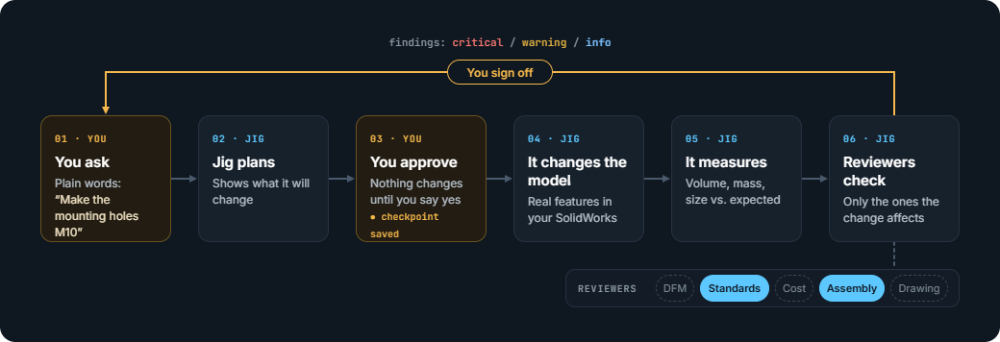

# Jig

*A jig holds the work and guides the tool so every part comes out right. This one does that for AI in your CAD.*

https://github.com/user-attachments/assets/d11cb1b0-ee66-4194-9ba5-494125389d1b

A Claude Code plugin for mechanical engineers working in real CAD. Ask for what you need in plain
language, like "make the mounting holes M10", "can this be milled?" or "design a bracket for 50 kg".
The **orchestrator** picks only the steps and reviewers the request needs:

- **Blueprint** keeps the design's spec and changes the model, checking every write.
- **Red Line** critics review only what the change can affect: DFM, standards, cost, assembly,
  drawing.
- You see the plan and confirm it before anything in the model changes.

For new designs there is also a thought-through mode: a full spec first, then a build → review → fix
loop until no critical flags remain. The pattern (a stateful drafter plus stateless critics) comes from
Google's Elephant-Goldfish model.



**CAD connectors:** SolidWorks (bundled). The agents are CAD-agnostic, and more connectors can be
added without changing them (see [Adding a connector](#adding-a-connector)).

## Install

Requirements: Windows with SolidWorks installed and **running**, Claude Code, and
[uv](https://docs.astral.sh/uv/getting-started/installation/).

```text
/plugin marketplace add NejcDvorsek/jig
/plugin install jig@jig-cad
```

The plugin registers its SolidWorks MCP server, [`sw-mcp`](https://github.com/NejcDvorsek/sw-mcp), itself,
and uv fetches it from PyPI on first start, so there's nothing else to configure. Check the setup with
`/jig:doctor`.

To update, run `/plugin marketplace update jig-cad`, update `jig` in `/plugin`, and restart Claude
Code. Each Jig version pins the `sw-mcp` server version it was tested with, so the server updates
along with it.

## Examples

What Jig did on real work, with screenshots and drawings: [docs/examples.md](docs/examples.md).

- [From a solid part to bent sheet metal](docs/examples.md#from-a-solid-part-to-bent-sheet-metal):
  DFM finds a part that can't be laser cut and bent, and Jig splits it into a flat plate and a bent
  U-bracket with a flat-pattern drawing
- [Missing bolt holes](docs/examples.md#missing-bolt-holes-and-a-problem-nobody-asked-about): holes
  matched to existing brackets, full fastener spec, and an overlap nobody asked about
- [Assembly drawing with BOM](docs/examples.md#assembly-drawing-with-bom): balloons, a bill of
  materials and a CSV for a 39-item assembly
- [Overall dimensions](docs/examples.md#overall-dimensions): an overall-dimensions drawing of the
  assembly
- [A new design from one sentence](docs/examples.md#a-new-design-from-one-sentence): a 50 kg wall
  bracket from spec to reviewed part and drawing

## Everyday use

Just ask. The orchestrator triggers automatically, or you can call it:
`/jig:orchestrator "<what you need>"`.

| You say | What runs |
|---|---|
| "what's the thinnest wall?" | Inspect only. No critics, nothing written |
| "make the mounting holes M10 so the new bolts fit" | plan → **your confirm** → edit → Standards + Assembly (focused on those holes) → records *CON: holes accept M10* |
| "add R3 to the pocket corners" | plan → confirm → edit → DFM |
| "change it to 6082, it's cheaper" | plan → confirm → edit → Cost + Standards + DFM |
| "can this be milled?" | DFM (+ Cost) review, no changes |
| "these bolts are always A4 stainless from now on" | records the constraint, then checks the model against it |
| "undo that" | restores the last checkpoint |
| "design a bracket for 50 kg …" / "release review" | design mode (below) |

Each change ends with one line saying what ran and why, e.g. *"Ran Standards + Assembly (hole on
interface INT-001). Skipped DFM / Cost / Drawing: not affected. Logged as change 04."* Flags caused by
your change come first; problems that were already there are listed separately.

How it decides is a readable, editable table: [`docs/impact-map.md`](docs/impact-map.md).

| Request | Pipeline |
|---|---|
| questions, cosmetic changes | inspect / edit only |
| any other change | edit + the affected critics, focused on the change |
| new designs, release, "iterate until clean" | full spec + converge loop (offered, never started without a yes) |

A change that touches an interface, a requirement-bound value or an assembly, or several kinds of
change at once, also gets a **baseline**: a snapshot from before the edit, so the critics can tell
what the change caused, plus a requirement re-check. "Just do it" skips the critics (the edit is
still verified and logged), and "full review" adds the baseline and every possibly affected critic.

**Faster runs.** The reviews take most of the time, so you choose when they run:

| Say | Effect |
|---|---|
| "quick: …" / "just do it: …" | no snapshot and no critics. The edit is still checked and logged |
| "… review later" | no critics now. The change is logged as *pending*, and `/jig:redline` later reviews all pending changes in one run |
| "… review: assembly only" | exactly the critics you name |
| "it's a one-off prototype" / "we need 200 a year" | recorded as the quantity. Cost runs only with a cost target or a quantity above 5 |

The snapshot reads only the sections the chosen critics need. With a server that has `read_model`
(sw-mcp 0.2.0 or later) that is one call, and holes, concave edges, walls and setups come from the
SolidWorks API rather than being guessed from faces. Older servers fall back to a slower recipe.
Each topic has one owning critic (`docs/critic-protocol.md`), so a problem is reported once.
The snapshot agent and the Cost, Drawing and Standards critics run on Sonnet. DFM and Assembly use
your session's model. Change a critic's `model:` line in `agents/` to adjust this.

**The spec builds up as you work.** The first change to a part creates a small blueprint for it.
Every "it has to…" you say is recorded as a constraint and shown in the plan, so you can say "drop
that". Later reviews check against everything recorded.

## Design mode

```text
/jig:init "bracket for a 50 kg static load, aluminium, 4× DIN 912 M10 to the wall, CNC milled"
/jig:converge
```

`init` writes the full spec: requirements, constraints, parameters sized by hand calculation,
interfaces, standards and open questions. `converge` asks once, then loops: Blueprint builds or
updates the model, all five critics review it in parallel, and Blueprint fixes, defers or escalates
each flag. It stops at zero open criticals, when only your decisions are left, when two passes make
no progress, on a CAD error, or at the iteration cap (default 5).

To steer, edit `blueprint.md`: change values, set `locked: yes` on a parameter, answer open questions,
or mark a flag `overridden`. Then run it again.

## Commands

| Command | Use | Changes the model? |
|---|---|---|
| `/jig:orchestrator "<anything>"` | default entry point (also automatic) | only after your confirm |
| `/jig:init "<intent>"` | full spec for a new design | no |
| `/jig:converge [--max N]` | full build/review loop | yes, after one confirm |
| `/jig:redline [dfm,cost] [focus: …]` | explicit review with chosen critics | no |
| `/jig:snapshot` | dump the model to neutral JSON | no |
| `/jig:doctor` | check uv, connector, CAD, project | no |

## What ends up in your project

```text
blueprint/
├── rules.md                 (optional) house design rules. Every critic applies them
└── <part-or-assembly>/      one folder per design you touch
    ├── blueprint.md         spec: constraints, parameters, decisions, flag register (lite → full)
    ├── changelog.md         every change: your request, what changed, which flags, checkpoint
    ├── snapshots/  redlines/  checkpoints/  shots/
```

## How it works

- **Critics are a pure function**: `(blueprint, snapshot, focus, baseline) → flags`. Because they only
  see neutral files, they don't depend on the CAD system.
- **A critic can't block with a guess.** A critical flag needs cited evidence. A check the data can't
  support is `info`, "unverifiable".
- **Safety:** a checkpoint copy of the model before every change, no writes to locked parameters or
  to your own features without asking, and the typed CAD tools only (no scripts).

| Persona | Checks |
|---|---|
| DFM | wall thickness, draft, undercuts, internal radii vs tool, hole depth, setups (per process) |
| Standards | ISO 2768, ISO 286 fits, ISO 273 clearance holes, DIN 974 counterbores, threads, EN materials |
| Cost | stock utilisation, material, setups, tool variety, tolerances, fasteners, unit-cost estimate |
| Assembly | interference, clearances, hole-pattern alignment, fits, worst-case/RSS stack-ups, tool access |
| Drawing | title block, projection, views, dimensions, hole callouts, GD&T, surface finish (reads the PDF) |

There is no FEA in v1. Blueprint keeps hand calculations for each load requirement in the spec.

## Known limits (SolidWorks connector)

- It runs on Windows only and needs SolidWorks already open. The server attaches to it but won't
  start it.
- Only SolidWorks is supported for now. Jig is built to work with other CAD programs, but SolidWorks
  is the only connector so far.
- Long sessions slow SolidWorks down, because its memory use grows over time. On a low-memory
  warning, save and restart SolidWorks between runs, never during one.

See [`connectors/solidworks/CONNECTOR.md`](connectors/solidworks/CONNECTOR.md).

## Adding a connector

Write one adapter file. Critics, schemas, the orchestrator and the loop stay untouched. See
[`docs/connector-contract.md`](docs/connector-contract.md).

## License

MIT. The connector server [`sw-mcp`](https://github.com/NejcDvorsek/sw-mcp) is a separate MIT-licensed
project, installed from PyPI at runtime. It is a fork of Henk Jan Baard's
[SolidWorks-MCP](https://github.com/hjbaard/SolidWorks-MCP).
