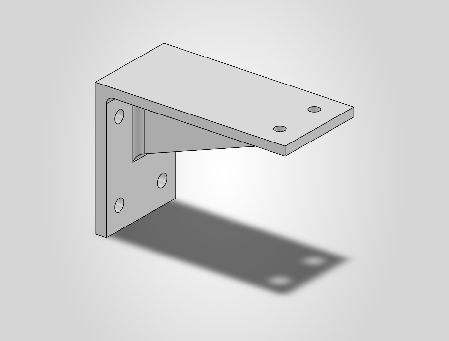
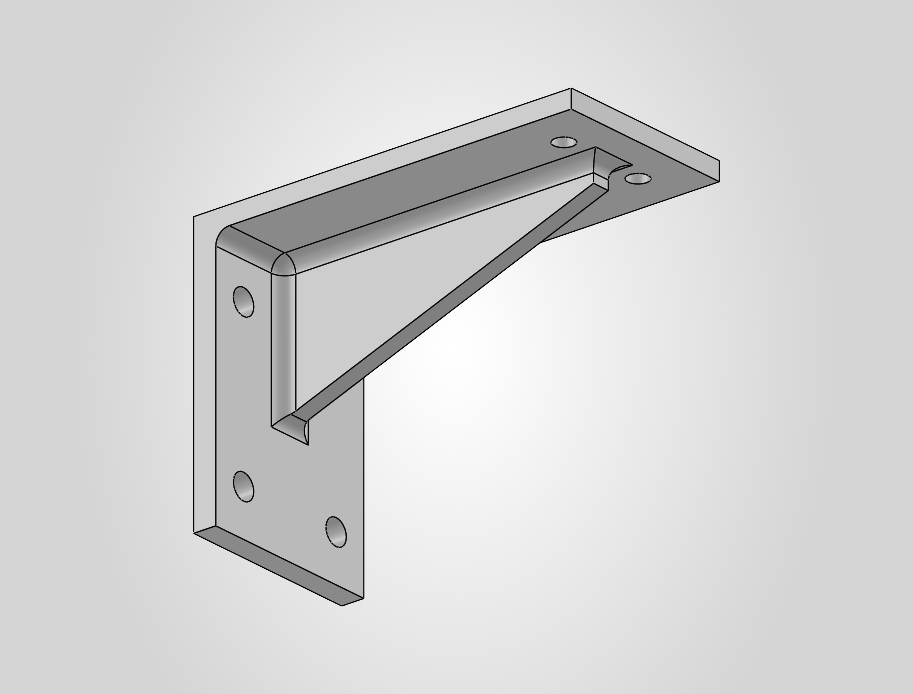
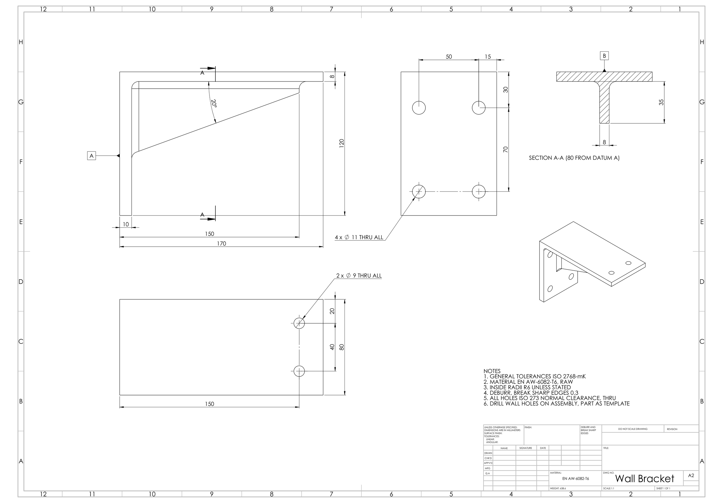

# Examples

The first four examples come from one real project: a vertical camera-positioning frame with Y and Z
ball-screw drives (39 BOM items). An engineer modelled the assembly by hand in SolidWorks. Jig was
used on it afterwards, to review it, change it and draw it. The last example is a new part that Jig
designed from one sentence.

## From a solid part to bent sheet metal

*"is the Y plate manufacturable?"* The DFM critic found that the plate under the Y ball nut was a
solid 10 mm hat section with sharp (R0) inner corners. It can't be laser cut and bent, as the spec
requires. Jig proposed splitting it, and on the engineer's yes it built two new parts: a flat
laser-cut plate and a small 3 mm U-bracket for the nut housing. The old part file was left as it
was.

| Before: one solid hat section, R0 bends | After: flat laser-cut plate, 10 mm | After: bent U-bracket, 3 mm |
|---|---|---|
|  |  |  |

In the assembly the U-bracket (orange) bridges the notch in the plate (blue), bolted to it by its
flanges, and holds the Y ball-nut housing. Jig replaced the old plate in place, mated both parts
and checked the clearance to the ball-nut flange (3 mm):


*"change the part from extruded to sheet metal and create a drawing"*. Jig rebuilt the U-bracket as a
SolidWorks sheet-metal part (4 bends, R4.5, K 0.42) with the same holes and the same mass
(0.175 kg), checked the flat blank against a hand calculation (233.19 × 95 mm), and made the drawing
with the flat pattern and bend notes:


## Missing bolt holes, and a problem nobody asked about

*"there are holes missing for the brackets that join the camera plate to the Y plate"*. Jig read the
hole positions off the two angle brackets (yellow) and added matching Ø9 holes: 4 in the Y plate
(blue) and 8 in the camera plate (green), each one checked coaxial with its bracket hole (offset
0.0 mm).

| Camera plate with the 8 new holes | The joint in the assembly |
|---|---|
|  |  |

The change touched an interface, so the Standards and Assembly critics reviewed it. They:

- wrote out the fasteners: 12× ISO 4762 M8×30-8.8 + ISO 7089 washer + ISO 7040 nut, with heads
  inside the bracket, because nuts there would clash at the corner holes;
- checked the clearance to the linear module below (59 mm);
- found a **1.13 mm overlap** between a bracket and the Y plate that was already in the model and
  now sits under a bolted joint. It went to the engineer as a critical flag, not a silent fix.

## Assembly drawing with BOM

*"give me a balloon drawing of the assembly with a bill of materials"*. Three views, one balloon per
BOM item, and a CSV of the BOM. Parts hidden in the model (camera, lenses, protective glass) are
drawn as dashed outlines.


## Overall dimensions

*"a separate drawing with the overall dimensions of the assembly"*


## A new design from one sentence

```text
/jig:init "bracket for a 50 kg static load, aluminium, 4× DIN 912 M10 to the wall, CNC milled"
```

`init` asked three questions and wrote the spec with hand calculations (7.8 MPa at the wall,
safety factor 32). `converge` built the part and ran all five critics. They found too little
M8 thread in the 8 mm flange, missing washers under the M10 heads and a sharp inside edge, and
then caught that their own fix for the threads needed an extra machine setup. The engineer
settled it with plain through holes.

| The bracket, 0.64 kg | From below |
|---|---|
|  |  |


